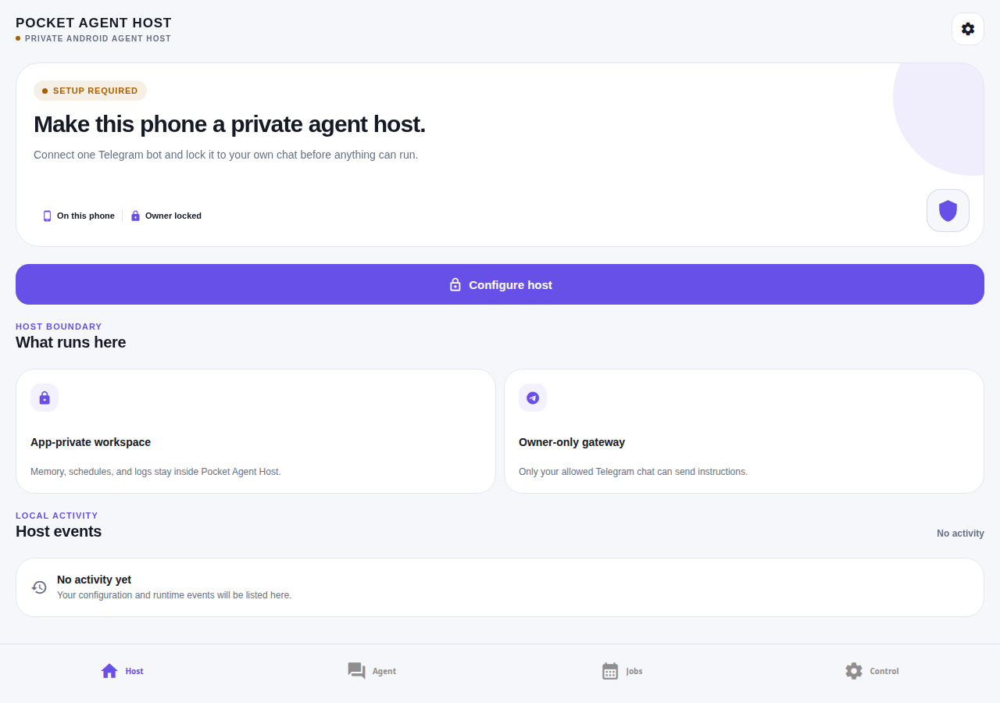
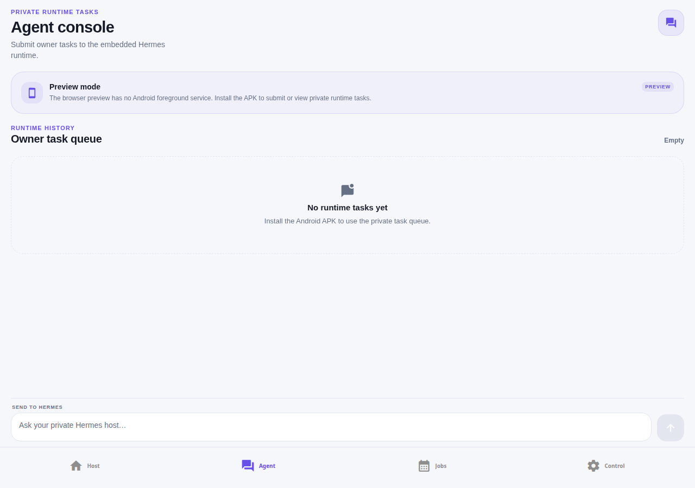
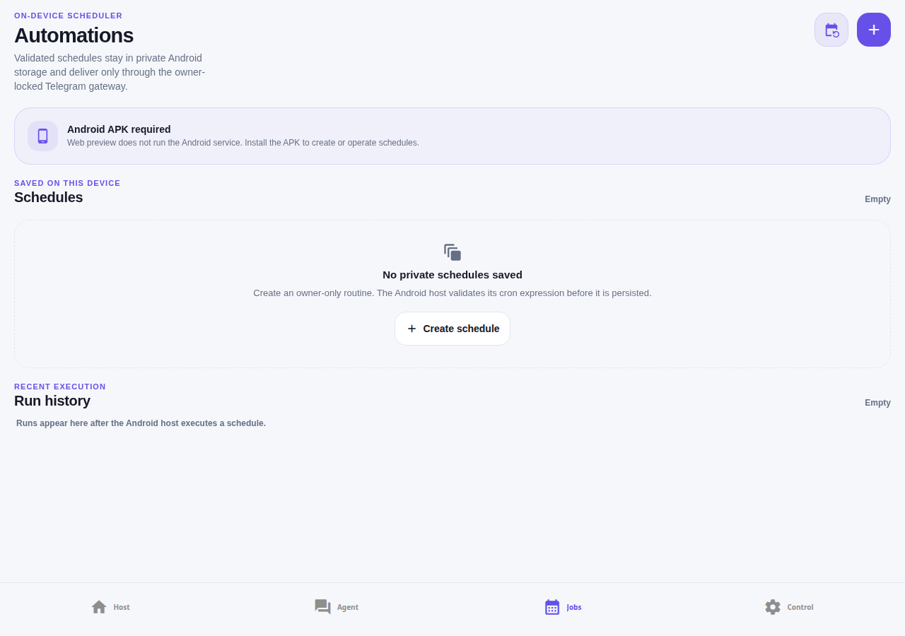
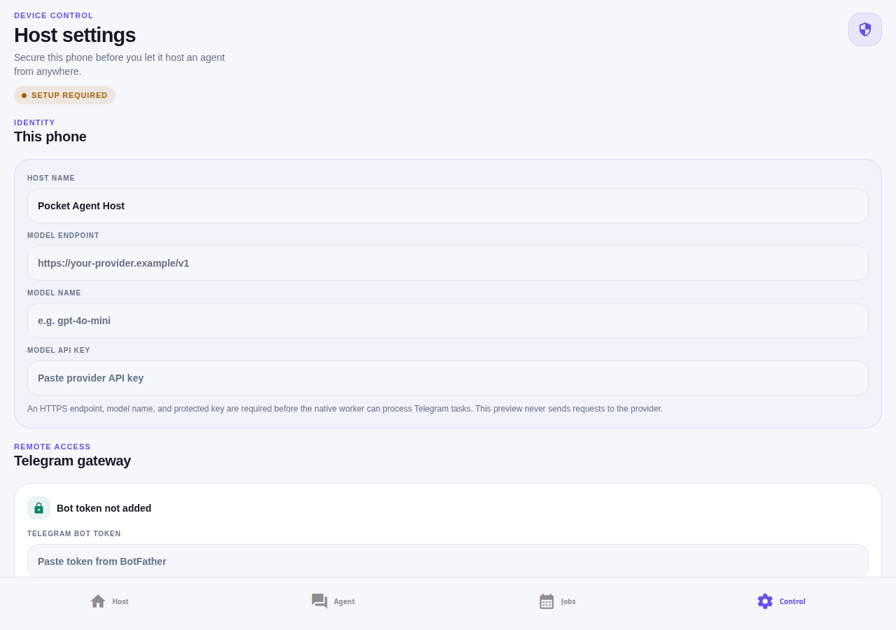

# Pocket Agent Host


**Pocket Agent Host** is a FOSS Android control plane that turns a spare phone into a private, self-hosted AI agent host. The phone runs an app-private embedded CPython/Hermes runtime under an Android foreground supervisor, while the owner controls the host remotely through a private Telegram bot.

> **Status:** The source is published at [`gitlab.com/theredhacker0345/pocket-agent-host`](https://gitlab.com/theredhacker0345/pocket-agent-host) on the default branch. The previously used release tags were removed while their commits remain reachable in repository history. The app is prepared as an F-Droid-oriented release candidate; a fresh APK and physical-device acceptance testing remain required before claiming F-Droid publication.

## What it does

Pocket Agent Host is designed for a dedicated, plugged-in Android phone. It bundles the runtime inside the application so the owner does not install or expose Termux, a terminal, a Linux distribution, or a separate package manager. The control plane makes the host boundary visible: private storage, owner-only Telegram access, protected credentials, local schedules, bounded diagnostics, and honest native-versus-preview states.

| Area | Included behavior |
|---|---|
| **Remote control** | Private-owner Telegram gateway for sending tasks and receiving owner-directed responses. Group messages and unverified chats are rejected by policy. |
| **Model access** | Select an OpenAI-compatible provider preset, enter its protected API token, fetch its current `/models` catalog, choose a model, and run native preflight before the worker starts. |
| **Remote MCP connectors** | Add an owner-selected HTTPS MCP server, discover its tools, and grant a named tool a short, explicit approval before it can run through the private task boundary. |
| **24/7 operation** | Android foreground service, persistent notification, opt-in boot recovery, charging/storage readiness gates, owner-set CPU/RAM/private-workspace guardrails, bounded recovery attempts, and a 30-minute wake-check daemon. |
| **On-device control plane** | Dashboard, setup wizard, Agent console with live context-window usage and manual compression, Automations scheduler, Settings, task history, schedule run history, and local host events. |
| **Host telemetry** | Native CPU/RAM/workspace readings, device capacity, battery/charging state, storage readiness, freshness labels, near-limit visual warnings, and policy-driven low-battery or low-storage alerts. |
| **Open-source release** | GPLv3-licensed app code, retained upstream Hermes attribution, Python and JavaScript SBOMs, license audit, F-Droid metadata, and unsigned-by-default release configuration. |

## UI gallery

These screenshots are captured from the current live control-plane preview. The web preview deliberately labels Android-only capabilities instead of pretending that it can start the foreground service or access native CPU/RAM telemetry.

| Host dashboard | Agent console |
|---|---|
|  |  |

| Automations | Host Settings and model credentials |
|---|---|
|  |  |

The launcher artwork used above is the same source icon shipped through the Android, splash, favicon, and adaptive-icon asset paths: [`assets/images/icon.png`](assets/images/icon.png).

## User flow

The first launch opens a four-step Host Setup flow. The owner names the phone, enters the Telegram bot token and private owner chat ID, selects an OpenAI-compatible model provider, enters its protected API token, refreshes the provider’s current model catalog, chooses a model, and selects the runtime policy. The app validates the required fields before handing configuration to the Android supervisor.

After setup, the owner can run a Telegram gateway test, inspect charging and storage readiness, start or pause the supervisor, submit a durable task from the Agent console, inspect the active owner session's numeric context-window usage, request Hermes' supported manual compression of earlier turns, create a validated five-field cron schedule, and review bounded local history. Settings also store bounded CPU, process-RAM, and app-private workspace limits. A hardware-aware **Recommended limits** action derives conservative values from Android-reported CPU cores, total RAM, free storage, and the owner’s required storage reserve; it only fills the editable fields, so the owner must still review and save them. The dashboard and Settings surface visible alerts at 80% of a selected guardrail and critical alerts at 95%; missing native data never produces a guessed alert. The Android supervisor stops the host after a sustained CPU breach or immediately for RAM/workspace breaches; the worker rejects new task and schedule persistence when its private workspace quota is full. These are host-process guardrails, not device-wide cgroups or a replacement for Android’s own memory management. The context bridge never renders or transfers a transcript to the control plane; compression is disabled while an owner task is active and leaves the existing conversation unchanged if it cannot complete safely. Settings can remove protected credentials; deletion stops the host and clears native configuration rather than merely hiding the fields.

### Model provider fields

| Field | Example | Handling |
|---|---|---|
| **Provider** | OpenAI, OpenRouter, Groq, Mistral AI, or Custom compatible | Selects the provider preset and its compatible model-list endpoint. Custom endpoints remain available for other HTTPS OpenAI-compatible services. |
| **Model endpoint** | `https://provider.example/v1` | Must be HTTPS and OpenAI-compatible. The app requests `GET /models` and the native preflight checks the endpoint before worker startup. |
| **Provider API token** | Provider-issued secret | Stored through Android protected storage and excluded from normal UI state, telemetry, activity history, model records, and diagnostics. |
| **Selected model** | `gpt-4o-mini` or a provider-specific compatible model | Choose from the fetched catalog or enter an ID manually; stored as non-secret host configuration. |

The catalog is refreshed explicitly from Host Setup or Settings and displays the latest successful result without high-frequency background polling. The provider is selected by the owner. Pocket Agent Host does not operate a model relay or claim ownership of prompts and responses; prompts and responses travel to the configured provider when the agent is used. See [`docs/privacy.md`](docs/privacy.md) and [`docs/provider-model-discovery-research.md`](docs/provider-model-discovery-research.md).

## Architecture

```text
Pocket Agent Host UI
        │
Typed React Native / Expo module bridge
        │
Kotlin Android foreground supervisor
        ├── Android Keystore-backed configuration
        ├── boot recovery and readiness policy
        ├── CPU/RAM telemetry and diagnostics
        ├── lifecycle, scheduler, task queue, and secret-free context bridge
        │
Embedded CPython 3.11 worker
        ├── Hermes Agent 0.20.1
        ├── private-owner Telegram gateway
        ├── durable task queue and cron scheduler
        ├── HTTPS model-provider preflight
        └── owner-approved HTTPS remote MCP client and session-preserving compression
```

The runtime has no interactive terminal surface. Its workspace is app-private, recovery is bounded, diagnostics are redacted, schedules and tasks are owner-scoped, and Telegram authorization fails closed unless a private owner identity is present. Owner resource settings supervise only the app process and its private runtime directory: they do not grant the model a shell, root access, access to other apps, or a device-wide resource controller. Remote MCP connectors are HTTPS-only, reject directly addressed local/private network targets and redirects, do not launch local processes, and require a current owner tool grant. The authoritative implementation map is [`docs/implementation-traceability-matrix.md`](docs/implementation-traceability-matrix.md), with security details in [`docs/threat-model.md`](docs/threat-model.md) and connector details in [`docs/mcp-connectors.md`](docs/mcp-connectors.md).

## Build and development

The project uses Expo SDK 54, React Native 0.81, Expo Router 6, TypeScript, NativeWind, a local Android Expo module, and Chaquopy 17 for the embedded Python runtime. The JavaScript preview is Metro-only; the Android foreground service is available only in a custom Android build.

```bash
pnpm install
pnpm dev
```

Run the source validation gates with:

```bash
pnpm test
pnpm check
pnpm run sbom:js
pnpm run sbom:python
pnpm run audit:licenses
pnpm run release:preflight
```

A native ARM64 release build requires the documented Android SDK, NDK, Java, private CPython toolchain, and prebuilt wheels. The constrained build command is documented in [`docs/reproducible-release-policy.md`](docs/reproducible-release-policy.md). Do not rebuild the APK in a memory-constrained environment unless `.artifacts/wheels/` contains the required ARM64 wheels and `POCKET_HERMES_BUILDPYTHON` points to the configured CPython 3.11 executable.

## Release evidence

The release evidence record separates source-side verification from checks that require external hardware or publication infrastructure.

| Evidence | Current result |
|---|---|
| Deterministic policy, contract, security, and UI tests | Passed in the sandbox |
| TypeScript check | Passed with `tsc --noEmit` |
| JavaScript SBOM | Generated from the production dependency graph |
| Python SBOM | CycloneDX 1.6 generated for pinned embedded runtime components |
| License audit | Zero manual-review and zero blocked findings in the recorded release gate |
| Release configuration | Unsigned-by-default F-Droid path; no debug-key fallback |
| Existing ARM64 APK | Preserved and hash-verified historical artifact; a fresh post-tag build is still required for publication evidence |

Read [`docs/release-evidence.md`](docs/release-evidence.md) for the exact recorded artifact hash, evidence boundaries, and F-Droid requirements. The F-Droid maintainer checklist is [`docs/fdroid-submission-checklist.md`](docs/fdroid-submission-checklist.md), and the upstream recipe is [`metadata/com.app.pockethermes.yml`](metadata/com.app.pockethermes.yml).

## Privacy and security boundaries

Pocket Agent Host contains no analytics SDK, advertising SDK, account system, or Pocket Agent Host-operated cloud relay. Host readiness, CPU/RAM, battery, storage, task state, schedule state, and bounded diagnostics remain in application-private storage. Telegram traffic leaves the device through Telegram when the configured bot is active, and model prompts/responses leave through the HTTPS endpoint selected by the owner.

Credentials are not printed in logs or included in ordinary activity records. Android builds use protected storage backed by Android Keystore-backed mechanisms. The context control surfaces only numeric owner-session window metadata; conversation content never crosses the Python/Kotlin/JavaScript bridge. A manual compression request invokes the embedded Hermes session flow, which may send the selected earlier conversation to the already-configured model provider to create its replacement summary. Owners can delete Telegram and model credentials from Settings, which invokes native deletion and stops the host. MCP bearer credentials follow the same protected path; tool arguments and results may leave the device through an owner-selected MCP server when an approved tool is called. The app does not ship root access, unrestricted shell execution, a system-wide file scanner, or package installation.

## Licensing and attribution

Pocket Agent Host application code is released under the [GNU General Public License, version 3 only](LICENSE). The embedded runtime uses the MIT-licensed [Hermes Agent](https://github.com/NousResearch/hermes-agent) project from Nous Research. Pocket Agent Host is independently maintained and is not an official Nous Research product. Hermes copyright and license notices, as well as every other applicable third-party notice, remain in force and must travel with distributions that include those components. See [THIRD_PARTY_NOTICES.md](THIRD_PARTY_NOTICES.md), [COPYRIGHT_POLICY.md](COPYRIGHT_POLICY.md), and [CONTRIBUTORS.md](CONTRIBUTORS.md).

## Contributing

Contributions should preserve the private-owner boundary, keep native-only states honest in web preview, avoid telemetry and proprietary runtime dependencies, and add deterministic tests for new policy or persistence behavior. Before opening a merge request, follow [CONTRIBUTING.md](CONTRIBUTING.md), run the validation commands above, and update the relevant traceability, privacy, threat-model, F-Droid, or licensing documentation when behavior changes.

## References

[1]: https://gitlab.com/theredhacker0345/pocket-agent-host "Pocket Agent Host GitLab repository"

[3]: https://github.com/NousResearch/hermes-agent "Hermes Agent upstream repository"

[4]: https://f-droid.org/en/docs/Build_Metadata_Reference/ "F-Droid Build Metadata Reference"

[5]: https://f-droid.org/en/docs/Reproducible_Builds/ "F-Droid Reproducible Builds"

[6]: https://developer.android.com/develop/background-work/services/fgs "Android foreground services"

[7]: https://developer.android.com/privacy-and-security/keystore "Android Keystore system"
